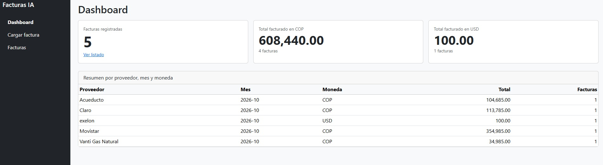
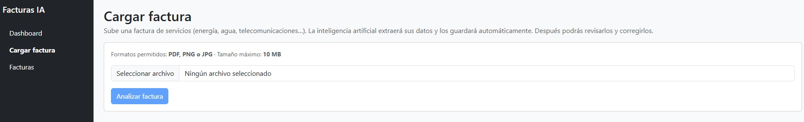
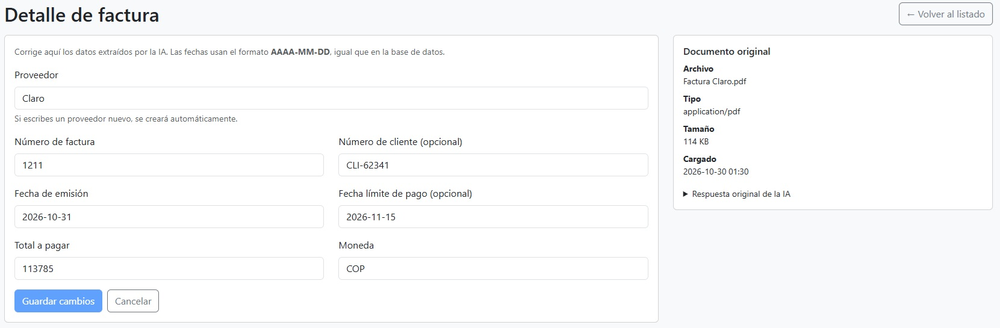

# Gestión de facturas con extracción por LLM

Aplicación web que permite cargar facturas (PDF, PNG, JPG), extraer sus datos con un modelo LLM, se guarda en SQL Server para consultarlas, corregirlas y eliminarlas desde el front.



## Stack
| Capa | Tecnología |
|---|---|
| Frontend | Angular (TypeScript), formularios reactivos, Bootstrap (solo CSS) |
| Backend | Node.js con NestJS (TypeScript), TypeORM |
| Base de datos | SQL Server en Docker |
| LLM | Google Gemini, modelo `gemini-3.1-flash-lite-preview` |

## Requisitos
- Node.js (LTS)
- Docker Desktop
- Git
- Una API KEY (para este ejmplo Gemini, se obtiene gratis en Google AI Studio.)

## Puesta en marcha

### 1. Copia `.env.example` a `.env` y define `mi_contraseña_super_secreta`.
```bash
cp .env.example .env
cp backend/.env.example backend/.env
```

### 2. Levanta SQL Server
```bash
docker compose up -d
```

### 3. Crea el esquema de la base de datos El **esquema** es la estructura de la base: las tablas, sus columnas, claves e índices. Está en `database/01_schema.sql`.

### 4. Inicia el backend
```bash
cd backend
npm install
npm run start:dev
```
Comprueba que responde y alcanza la base: <http://localhost:3000/api/health> debe devolver `{"status":"ok","database":"up"}`.

### 5. Inicia el frontend
En otra terminal:
```bash
cd frontend
npm install
npm start
```
Abre <http://localhost:4200>.

## Uso de la aplicación
| Pantalla | Ruta | Qué hace |
|---|---|---|
| Dashboard | `/dashboard` | Número de facturas, total facturado por moneda y resumen por proveedor y mes |
| Cargar factura | `/cargar` | Vista previa del archivo, barra de progreso, análisis con IA y resultado |
| Facturas | `/facturas` | Listado con filtros y paginación, edición y eliminación con confirmación |
| Detalle | `/facturas/:id` | Formulario con validaciones, y el documento y la respuesta original de la IA |




## Variables de entorno
**`.env`**:
| Variable | Descripción |
| :--- | :---: |
| DB_PASSWORD | Contraseña de SQL Server |

**`backend/.env`**:

| Variable | Descripción | Ejemplo |
|---|---|---|
| `PORT` | Puerto de la API | `3000` |
| `DB_HOST` | Servidor de base de datos | `localhost` |
| `DB_PORT` | Puerto de SQL Server | `1433` |
| `DB_USER` | Usuario | `sa` |
| `DB_PASSWORD` | **La misma** contraseña de la raíz | |
| `DB_NAME` | Nombre de la base | `facturas` |
| `LLM_API_KEY` | Clave de la API | |
| `LLM_MODEL` | Modelo a usar | `gemini-3.1-flash-lite-preview` |

## API REST

Base: `http://localhost:3000/api`

| Método | Ruta | Descripción | Respuestas |
|---|---|---|---|
| POST | `/facturas` | Recibe el archivo, invoca el LLM valida y almacena el resultado | 201, 400, 409, 413, 415, 422, 502  |
| GET | `/facturas` | Lista paginada, con filtros `proveedor`, `desde`, `hasta`, `page`, `pageSize` | 200, 400 |
| GET | `/facturas/:id` | Devuelve el detalle de una factura | 200, 400, 404 |
| PUT | `/facturas/:id` | Corrige los datos de una factura | 200, 400, 404, 409, 422 |
| DELETE | `/facturas/:id` | Eliminación lógica | 204, 400, 404 |
| GET | `/facturas/reportes/resumen` | Total facturado por proveedor, mes y moneda (no suma monedas distintas ni facturas eliminadas) | 200, 500 |

### Códigos de error
| Código | Cuándo |
|---|---|
| 400 | Falta el archivo, o los datos no cumplen el formato |
| 404 | La factura no existe o fue eliminada |
| 409 | Factura duplicada (mismo proveedor y número) |
| 413 | El archivo supera los 10 MB |
| 415 | El tipo real del archivo no es PDF, PNG ni JPG |
| 422 | El modelo no pudo extraer datos válidos, o los datos son incoherentes |
| 500 | Error interno |
| 502 | El proveedor del LLM no respondió |

Todos los errores usan el formato *Problem Details* (`application/problem+json`):

```json
{
  "type": "about:blank",
  "title": "Recurso no encontrado",
  "status": 404,
  "detail": "No existe la factura con id 999.",
  "instance": "/api/facturas/999"
}
```

## Integración con el LLM
1. El backend valida el archivo (tamaño y tipo real) **antes** de llamar al modelo.
2. Envía el archivo a Gemini con instrucciones y un esquema JSON de salida(proveedor, número, fechas, total, moneda y campos opcionales).
3. Valida la respuesta del modelo con Zod: formatos, fechas que existan, total positivo, moneda de 3 letras y fecha límite no anterior a la emisión. Si falla, responde 422 con un mensaje legible.
4. Guarda Proveedor, Documento y Factura en una transacción.


### Decisiones de diseño
- **Eliminación lógica:** una factura es un documento contable que conviene conservar para auditoría. Se marca `eliminada = 1` y deja de aparecer en listados. El índice único es filtrado, así que se puede volver a cargar una factura eliminada.
- **Duplicados:** los controla la base de datos con un índice único sobre (proveedor, número de factura); la API responde 409.
- **Actualización:** el `PUT` se ejecuta en una transacción (resolver el proveedor y guardar la factura). La fecha límite de pago anterior a la de emisión devuelve 422.
- **Validación del archivo por su contenido.** Se comprueban los primeros bytes, no la extensión ni el tipo declarado por el cliente.
- **Llamada al LLM fuera de la transacción.** Así no se mantienen bloqueos en la base de datos mientras se espera una respuesta de red lenta.
- **Respuesta original del LLM.** Se guarda en `Documento.respuesta_llm` para trazabilidad y para revisar posibles errores de extracción.
